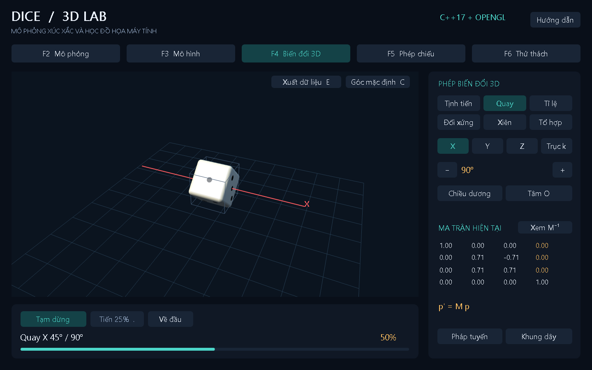

# DICE / 3D LAB - Bản đồ án học thuật

Mô phỏng Xúc xắc 3D & Trò chơi Đổ Xúc xắc bằng **C++17, OpenGL và FreeGLUT**. Trọng tâm là mô hình hóa, biến đổi, phép chiếu và hệ quan sát theo tài liệu môn học.



## Lấy dự án từ GitHub

```powershell
git clone https://github.com/dung241106/Dice_3d_project.git
cd Dice_3d_project
.\CHAY_THUYET_TRINH.bat
```

Có thể chọn **Code → Download ZIP**, giải nén rồi mở `CHAY_THUYET_TRINH.bat`. Repo kèm bản Windows đã build và các DLL cần thiết.

## Chạy ngay

Nhấp đúp **`run.bat`**. Bản đã biên dịch nằm tại `build/Dice3D_Edu.exe`, đi cùng hai DLL trong thư mục `build`. Khi mang sang máy khác, sao chép cả thư mục dự án.

```powershell
cd C:\Graphics_Com\project_3d_version2
.\run.bat
```

## Năm phần để demo

| Phím | Trang | Nội dung trình bày |
|---|---|---|
| F2 | Mô phỏng | 1–3 viên, lực đổ, chuyển động, nảy, va chạm, mặt trên thực tế, lịch sử |
| F3 | Mô hình | Khối cơ bản/bo cạnh, tách 6 mặt, chấm tròn, cơ sở u/v/n, khung dây |
| F4 | Biến đổi 3D | Chọn từng phép để chạy, chỉnh trục/mức biến đổi, tâm quay, tổ hợp và nghịch đảo |
| F5 | Phép chiếu | Phối cảnh, trực giao, xiên Cabinet, ba hướng nhìn, Model/View/Clip/NDC/Pixel |
| F6 | Thử thách | Ghép mặt trên và mặt trước của 3 viên, quay ±90°, gợi ý BFS trên 24 hướng |

F1 mở hướng dẫn, F11 toàn màn hình, F12 chụp ảnh. Chuột trái xoay camera, cuộn zoom, C trả góc nhìn mặc định.

### Mô phỏng

- Giữ Space hoặc nút lấy lực, thả để đổ. Chuột phải kéo trong khung 3D để lấy hướng và lực.
- 1/2/3 chọn số viên khi đang nghỉ. P tạm dừng, dấu `.` tiến 1/120 giây khi đã dừng.
- Có tốc độ chậm, ánh sáng, bóng đổ, pháp tuyến, trục XYZ, vật liệu nhựa/gỗ/kim loại và âm thanh.
- Số kết quả tính từ pháp tuyến của mặt hướng lên sau khi dừng. Lịch sử tự lưu vào `build/data/throws.csv`.

### Biến đổi

- Chọn **Tịnh tiến / Quay / Tỉ lệ / Đối xứng / Xiên**, chọn trục, rồi bấm **Chạy**. Mỗi lựa chọn tạo một minh họa riêng từ đầu.
- 1–5 chọn phép, X/Y/Z/K chọn trục, `+`/`-` chỉnh mức biến đổi. Có nút đổi chiều và chọn tâm O/P.
- Space chạy/tạm dừng. Dấu `.` hoặc **Tiến 25%** tiến một phần tư phép đang xem. **Về đầu** hoặc R đặt lại minh họa.
- Chọn **Tổ hợp** để xem riêng **T rồi R**, **R rồi T** hoặc **Phép ngược**.
- Đối xứng có mặt phẳng trong suốt và hình gốc làm mốc. Nó đổi hình ở cuối bước, tránh nội suy qua ma trận suy biến.
- E xuất thân lưới OBJ và chuỗi phép biến đổi CSV vào `build/data/exports`.
- Khi dùng trục k, hướng quay là vector `(1,1,0)`. Chọn **Tâm P** để quay qua `P=(1,0,0)`. X/Y/Z vẫn là các trục tọa độ.
- Nút **Hiện trục / Ẩn trục** bật tắt trục tọa độ và biểu tượng hướng ở góc cảnh. X đỏ, Y xanh lá, Z xanh dương. Mặc định tắt để cảnh gọn hơn.

### Trò ghép hướng

1–3 chọn viên. x/y/z quay +90°, Shift+X/Y/Z quay -90°. H gợi ý bước ngắn nhất, Space tạo bài mới. “Mặt trước” luôn là hướng **+Z thế giới**, theo trục xanh, độc lập với góc camera.

## Chuẩn bị thuyết trình

Mở **`docs/SLIDE_THUYET_TRINH.pptx`**, bản PDF dự phòng nằm cùng thư mục. Đọc `docs/KICH_BAN_DEMO.md` cho bài nói 8–10 phút và `docs/CAU_HOI_BAO_VE.md` để ôn câu hỏi. Báo cáo kỹ thuật ở `docs/BAO_CAO.pdf` và bản có thể sửa `docs/BAO_CAO.md`.

Nhấp **`CHAY_THUYET_TRINH.bat`** để mở một phiên sạch với seed 2026. Chế độ này giữ lịch sử trong RAM, không đọc/ghi lịch sử CSV của phiên thường. Bản thường `run.bat` vẫn tự lưu kết quả.

Tài liệu gốc đã được chép vào `docs/reference/CG_3D_Graphics.pdf`. Bảng đối chiếu trang và tính năng ở `docs/DOI_CHIEU_GIAO_TRINH.md`.

## Build và kiểm tra

```powershell
.\build_windows.bat -Test
.\run.bat --seed 2026
.\build\Dice3D_Edu.exe --smoke captures
```

Script tìm `g++.exe` trong PATH hoặc `C:\msys64\ucrt64\bin`. Nếu cần cài trên máy mới, chạy trong terminal **MSYS2 UCRT64**:

```bash
pacman -S --needed mingw-w64-ucrt-x86_64-gcc mingw-w64-ucrt-x86_64-freeglut
```

Trong VS Code, mở đúng folder `project_3d_version2`, nhấn Ctrl+Shift+B. Có cấu hình CMake cho môi trường có OpenGL/GLUT. Phần hiển thị tiếng Việt dùng font Windows qua WGL. Môi trường ngoài Windows có nhánh font GLUT dự phòng với khả năng Unicode hạn chế.

Code C++ có cấu hình `.clang-format`: thụt lề 4 dấu cách, dấu ngoặc khối xuống dòng và tách các câu lệnh. VS Code tự định dạng khi lưu file C++; nhấn Alt+Shift+F để định dạng thủ công.

Phân công thuyết trình cho ba thành viên ở [docs/PHAN_CONG_3_NGUOI.md](docs/PHAN_CONG_3_NGUOI.md).

## Cấu trúc mã nguồn

| Tệp | Vai trò |
|---|---|
| `include/dice.hpp`, `src/dice.cpp` | Vector, quaternion, mặt, chấm, sinh lưới, mặt trên |
| `include/lab.hpp`, `src/lab.cpp` | Ma trận 4×4, pháp tuyến, nghịch đảo, chuỗi biến đổi và playback |
| `include/view.hpp`, `src/view.cpp` | View, perspective, ortho, Cabinet, pipeline CPU |
| `include/throw_sim.hpp`, `src/throw_sim.cpp` | Tích phân, tiếp xúc, va chạm, dừng, lịch sử CSV |
| `include/puzzle.hpp`, `src/puzzle.cpp` | Đồ thị 24 trạng thái và BFS |
| `include/storage.hpp`, `src/storage.cpp` | Xuất thân lưới OBJ và bước biến đổi CSV |
| `include/ui.hpp`, `src/ui.cpp` | Giao diện OpenGL, nút và chữ tiếng Việt |
| `src/main.cpp` | Dựng cảnh, ánh sáng, camera, điều khiển, vòng lặp và kiểm tra OpenGL |
| `src/tests.cpp`, `src/throw_tests.cpp` | Kiểm tra hình học, phép chiếu, BFS, mô phỏng và dữ liệu |

## Phạm vi mô phỏng

Tiếp xúc bàn/thành dùng hàm support của khối bo. Va chạm giữa các viên dùng hình cầu đại diện. Khi gần dừng, chương trình nội suy 0,4 giây để mặt gần hướng lên nằm phẳng. Đây là mô phỏng có hỗ trợ ổn định trực quan, chưa phải bộ giải vật rắn đầy đủ và chưa có kiểm chứng phân phối xúc xắc công bằng. OpenGL dùng pipeline cố định để dễ đối chiếu kiến thức cơ sở.

Seed mặc định 2026 giúp tái hiện demo. Dùng `--seed <số>` để thay. CSV phục hồi các mặt kết quả, không phục hồi toàn bộ quỹ đạo cũ.
